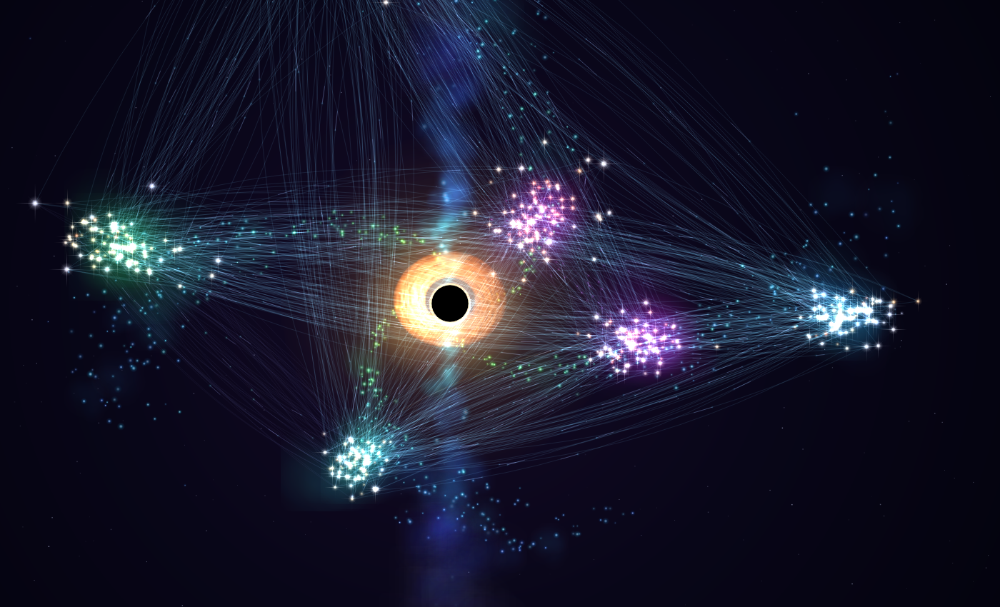

# Live Galaxy

Explore your Obsidian notes as a moving 3D galaxy. Notes become stars, links connect them, and a black hole sits at the centre.

**Desktop only.** Live Galaxy reads your notes but never changes them.



*Example with 500 sample notes, Ultra quality, and a black hole with a glowing disk and jets.*

## Features

### See your notes in space

- Each note has its own star. Notes with more links appear larger.
- Notes are grouped by folder across the galaxy's spiral arms.
- Zoom in to see planets, moons, rings, and asteroid belts.
- Planets can stand for linked notes or headings in the star's note. Some are just part of the scenery.
- Show or hide labels, links, and background clouds. Turn on **Orphans** to include notes with no links.

### Find and open notes

- Search by note name, text, tag, or folder.
- Click a search result to fly to **that note's own star** and open its note in the main window.
- Turn on **View → Focus on click** to bring the opened note's tab and window to the front. It is off by default, so you can keep exploring the galaxy.
- Press **Escape** to leave a close-up and return to the default galaxy overview.

### Choose the look

- Draw links as light pulses, tiny ships, a cosmic web, neon lines, or moving dashes.
- Choose which links to show, such as links across folders or notes that link to each other. Embedded notes and links in note properties have their own filters too.
- Choose from five black hole looks: Clean, Lensed disk, Classic, Quasar, and Gargantua. Change its size and turn its jets on or off.
- Adjust the camera angle, zoom, rotation speed, spiral arms, and planet motion.

### Explore your way

- Play the timeline to reveal notes in the order they were created.
- Save camera views and display settings as presets.
- Open the galaxy in its own window, without the usual Obsidian toolbars.
- Choose Low, Medium, High, or Ultra quality, or let Auto adjust it for you.
- Optionally show activity from other tools as streams flowing into the black hole. These connections are off by default.

## Install

### Manual install

1. Get `main.js`, `manifest.json`, and `styles.css` from a release or this repository.
2. Put all three files in `<vault>/.obsidian/plugins/live-graph/`. The folder must be named `live-graph`.
3. Restart Obsidian, then enable **Live Galaxy** under **Settings → Community plugins**.

### Install with BRAT

With [BRAT](https://github.com/TfTHacker/obsidian42-brat): add `paaaer/live-galaxy-plugin` as a beta plugin.

## Open the galaxy

Use the ribbon icon or run **Open Live Galaxy** from Obsidian's command palette.

To use a separate window, run **Open Live Galaxy in its own window**. A drag bar appears at the top when you move the pointer over it.

## Search

Type in the galaxy's search box, or click inside the galaxy and press `/`.

| Type | Finds |
| --- | --- |
| `meeting` | Notes with `meeting` in their name or path |
| `:project plan` | Notes containing `project plan` in their text |
| `#work` | Notes with tags starting with `#work` |
| `@Projects` | Notes with `Projects` in their path |

Search ignores letter case. Text searches need at least two characters after `:`.

Click a result to fly to the matching note's star and open the note. For text, tag, and folder searches, the list stays open so you can try another result. Pressing Enter highlights the matches; a plain name search also selects its first result.

## Controls

| Action | How |
| --- | --- |
| Turn the view | Drag, or use the arrow keys |
| Move the view sideways | Right-drag or Shift-drag |
| Zoom | Mouse wheel, or `+` / `-` |
| Open a note | Click its star or a planet linked to it |
| Open in a new tab | Ctrl-click, or Cmd-click on macOS |
| Zoom to a star or planet | Shift-click it |
| Fly to a note's star | Double-click it |
| Return to the default overview | Escape, Home, or `0` |
| Pause or resume the animation | Space |

For keyboard controls, click inside the galaxy first. Escape also works from buttons in the galaxy panel and from the search box, where it clears the search. It does not take over Escape while you edit other fields.

The on-screen **Home** button returns to the selected preset. Sliders have a small mark at their reset value; release near it to snap back.

## Permissions and privacy

Live Galaxy reads note names, links, tags, and headings through Obsidian. Text search also reads note text. It saves only its own settings, presets, activity counts, and access token in `data.json`. It never edits your notes.

It does not send data to outside servers, run shell commands, or evaluate code from strings.

Two optional connections are available under **Integrations** in the Galaxy panel:

| Option | What it does |
| --- | --- |
| **Stream API** | Lets local tools send small activity events to `127.0.0.1:27201` by default. It requires an access token, rejects requests with a browser Origin header, and cannot read or change vault content. |
| **REST hook** | If the Local REST API plugin is installed, watches its calls to animate activity. It sees file names and search queries but does not change the responses. |

Both are **off by default**. Older installs that already had them enabled keep them on.

## Development

Edit `main.js` directly. There is no build step.

Run the navigation tests with Node.js:

```powershell
node scripts\navigation.test.js
```

The drawing engine can also be tested without opening Obsidian. Install `@napi-rs/canvas` in a scratch folder and set `CANVAS_DIR` to that folder, then run:

```powershell
node scripts\smoke.js 800
```

`scripts\sync.ps1` copies the plugin files from a vault install into this repo. Use `scripts\sync.ps1 -ToVault` to copy them back. Check for local changes before copying.

For a release, update `manifest.json`, `versions.json`, and `CHANGELOG.md`. Run `scripts\release.ps1` to build `dist\live-galaxy-<version>.zip` from the current plugin files.

`data.json` (settings, presets, usage token) is never committed.

## License

MIT
